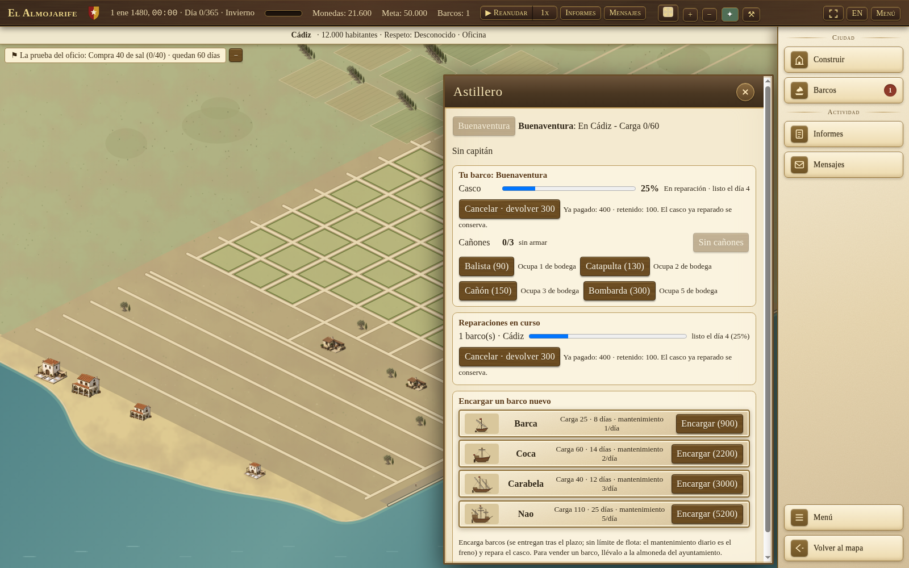
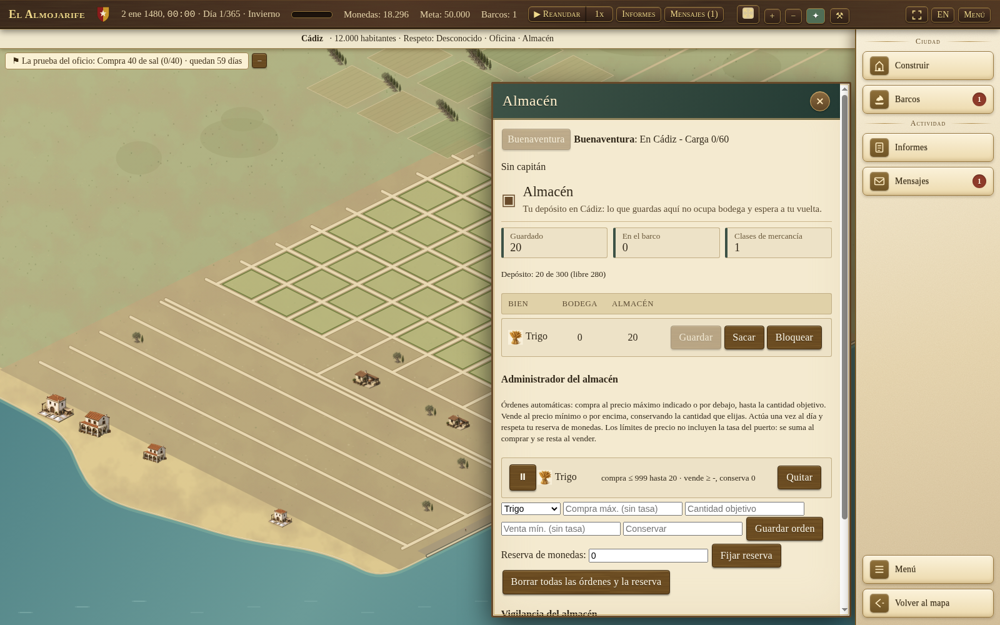
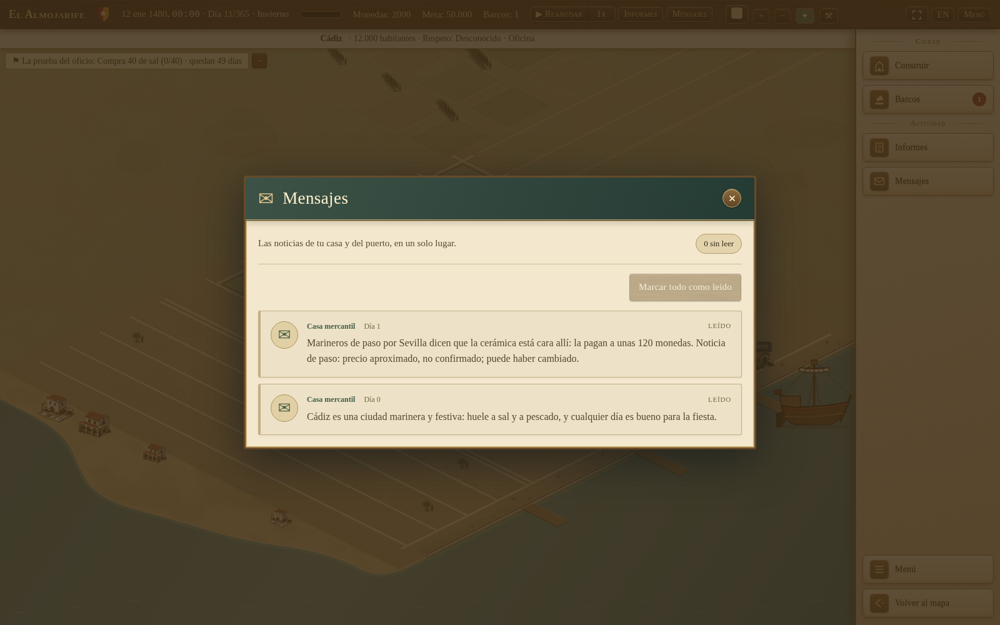
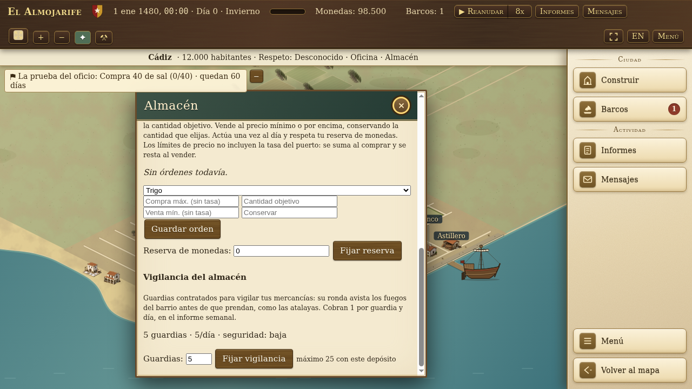

<p align="center"></p>

# El Almojarife

A maritime trading game set around Iberia and North Africa in the 15th-16th centuries. Found a merchant house, buy goods, sail between ports and sell at a profit. Manage ships, crews, automatic routes, buildings and your house's accounts.

**Desktop only:** keyboard and mouse on Windows, macOS or Linux. Phones and tablets are not supported. The interface is available in English and Spanish. Browser saves stay on your device; no player account is needed.

- [Play in a desktop browser](https://halcondeoro.github.io/almojarife-game/).
- [Source releases and release notes](https://github.com/HALCONDEORO/almojarife-game/releases).
- [Desktop packages: beta.2 (older build)](https://github.com/HALCONDEORO/almojarife-game/releases/tag/v0.5.0-beta.2). Newer source-only releases do not include installers.
- [Detailed player guide (Spanish)](docs/COMO-JUGAR.md).

## Version and beta status

This README describes integrated source through `1682657f585398e8419c7f3ea03b898ba33478d5` on 1 November 2026. **Source, the hosted game and desktop downloads are separate checkpoints.** An open PR is not a released feature, and this document does not certify the currently hosted build.

| Checkpoint | What it contains |
| --- | --- |
| [v0.5.0-beta.4](https://github.com/HALCONDEORO/almojarife-game/releases/tag/v0.5.0-beta.4) | Source-only checkpoint, published 28 October 2026 at immutable commit `b4abf57dc565b5858bdb30149627ae70e9c95af8`. No attached desktop packages. The later shipyard cargo-cost explanation (#671) is not in this tag. |
| [v0.5.0-beta.3](https://github.com/HALCONDEORO/almojarife-game/releases/tag/v0.5.0-beta.3) | Source-only pre-release, published 28 October 2026 at immutable commit `0a885d4db2b698bbe33ba4cf3d2b62407ba82bc1`. No attached desktop packages. Later main-branch navigation and Settings fixes are not in this tag. |
| [v0.5.0-beta.2](https://github.com/HALCONDEORO/almojarife-game/releases/tag/v0.5.0-beta.2) | Desktop binary checkpoint. Six desktop packages and `SHA256SUMS.txt`, published 27 October 2026. These packages do not contain later main-branch work. |
| Current source | Adds, since beta.4: visible shipyard weapon cargo costs, multi-day quoted hull **repair orders** with a visible cancellation refund and retained cost, warehouse **storage summary, outflow locks and hired watch** (guards, security grade, weekly wages), explicitly unconfirmed dockside price reports, effective-population and housing fixes, plus navigation, Settings, pause/save and recovery fixes. See the [changes since beta.4](https://github.com/HALCONDEORO/almojarife-game/compare/v0.5.0-beta.4...main); this comparison advances as main changes. |

The next beta checkpoint is due after **20 mainline merged PRs, or a large change**. The earlier dated source checkpoint `a5a880c` recorded 70 mainline PRs since beta.4, already past that threshold; this README does not maintain a live merge counter. Cutting a new release remains a manual decision. Release preparation still needs exact-commit review, green CI, relevant playtests and honest notes; the preparation workflow does not automatically publish or build desktop packages. No new release or installer is announced here.

This is an unfinished beta. Campaign completion, economy balance, save migration, accessibility and browser coverage are not declared complete. Export a save backup before trying another version. Compatibility with every older save is not promised.

## Start your first trading run

English button names are used below; the screenshots show the Spanish interface.

1. Choose **New game**, name your merchant house and character, and choose a home port. A new game opens the city and tutorial. Returning with Back keeps the form draft until a campaign starts (not across a browser reload).
2. Open **Market**, choose a quantity and buy a good. Check the price, your coins and available cargo space before buying.
3. Use **Back to map**. With your ship selected, **right-click** an explored port to sail in a new free-navigation game. Left-clicking is not a sail order. A charted but unexplored port is not the same as an explored destination.
4. Press **Resume** so time advances. At the destination, sell in its Market. The tutorial requires a manual, profitable sale of purchased cargo, not selling at a loss or letting an automatic route do it for you.
5. Visit the **Shipyard** with your docked ship. A sound hull completes the inspection for free; a damaged hull needs a normal repair order at the quoted price. Then visit **Town hall** and accept a council contract to complete the six-step tutorial. Missions wait while the tutorial is active; you can skip it or replay a completed/skipped tutorial from Settings.
6. Keep coins for upkeep and settlements. **Reports** holds trading history and accounts; **Messages** holds notices and events. Cargo value is not cash available to pay a bill.

The tutorial tracks buying, a profitable sale, sailing, a shipyard inspection or repair, visiting Town hall and accepting a council contract. The voyage after your purchase still counts when the profitable sale happens on arrival. Older saves may retain different rules, goals or tutorial steps.

## Map controls

| Action | Control |
| --- | --- |
| Give a free-navigation order | Right-click a valid explored port or permitted sea destination |
| Preview a destination | Move the pointer over the map for a route and estimated time; red feedback means invalid |
| Zoom | Mouse wheel, `+` / `-`, or a supported pinch gesture |
| Pan | Drag, arrow keys or `W`, `A`, `S`, `D` |
| Center on ship / port | Map buttons; `Home` / `C` |
| Move through the minimap | Click or drag inside it; it appears when zoomed in |
| Reset the view | Double-click |
| Pause / resume | Clock button; Space on the map when not typing |
| Close a window or cancel selection | `Esc`; use **Menu** to reach saves and Settings |
| Leave Settings | **Back** or `Esc`, returning to the menu/title that opened it |
| Mute / unmute | `M` |

Camera shortcuts do not type into text fields. Zooming or centering does not order the ship to sail. The map legend separates the faint network, active voyage, automatic route, plan and invalid destination.

In the ship window, **Follow** turns camera following on; **Stop following** turns it off. Escape, dragging or manually moving/centering the camera cancels following; the wheel preserves it. This is a view setting, not a simulation change, and it is not saved.

Older saves without free navigation keep the older destination-selection and **Sail** flow. Do not confuse that compatibility path with a new game's right-click controls.

## What you can manage

The current base world data contains **33 cities and 20 goods**. These are game data, not a claim of historically exact populations, borders or production.

- **Trading and information:** changing markets, cargo and warehouses, paid rumors/reports and incomplete knowledge of other ports. Dockside price reports are approximate and unconfirmed, may have changed, and keep their receipt day. They do not refresh confirmed market intelligence or accept a job. A price estimate is not a guaranteed profit.
- **Ships and crews:** construction, hull repairs, equipment, captains and convoys. Weapons occupy cargo space; the Shipyard shows each weapon's cargo cost before purchase. Repair cancellation shows the refund, original payment and retained cost before clicking; completed hull work remains. Rename a ship from the Fleet dropdown or its window. Sell ships at the **Town hall auction**, not the Shipyard; the last ship and ships with cargo cannot be sold.
- **Automatic routes:** simple return routes or advanced multi-stop buy/sell rules, price limits and a cash reserve. Routes can stall when stock, money or conditions are missing. Read their feedback and accounts rather than assuming steady profit.
- **Cities and your house:** a 2D city with selectable buildings, plots, warehouses, stewards, workshops, banking, contracts and council services. Costs and requirements are shown in each window; some buildings are scenery without services.
- **Warehouse automation:** a steward buys only the deficit to a stock target and sells above a chosen stock floor. A full outflow lock blocks voluntary sales, loading and construction withdrawals while still allowing storing and purchases; it is not a partial stock reservation or protection from legal seizure.
- **Voyage and campaign decisions:** weather, sea events, pirates, ranks, missions and council/justice systems. Availability depends on the game state; this is not a claim that the campaign has been fully playtested.
- **Settings:** language, text size, reduced motion, sound and time options. Large text keeps the Settings window within the viewport and scrolls its body when needed.

## Saves and recovery

Open **Menu** to save, manage slots, export/import or change Settings. **Continue** on the title screen loads the saved game. Browser storage does not sync across browsers or devices. Export before clearing site data or changing builds. Slot overwrite, load, delete and backup restore use in-game confirmation dialogs; Cancel is focused first. If storage is full or saving fails, the game reports the failure and offers export of the current campaign rather than claiming it was saved.

The game attempts additional autosaves every three minutes and when the page is hidden or left, when campaign data has changed. Browser lifecycle saves are best effort, not protection against every crash. Keep an exported copy of a campaign you care about.

## Real gameplay screenshots

These are from a **real new game**, in Spanish at 1280×720, played on source `ace71d6` on 28 October 2026, without injecting campaign state: buy in Cádiz, sail to Huelva, sell profitably, set an automatic route and visit Town hall. The playthrough completed all five tutorial flags and verified **Continue** after reload. These older market, route and council captures remain an explicitly dated playthrough, not a current-build or installer certification. The newer screenshots below are separate, dated source/hosted checkpoints, with synthetic fixture provenance.

| Market after arrival | Setting a route |
| --- | --- |
|  |  |


### Dated checkpoints: repair refund, warehouse lock and price reports



Captured from the public browser game on 1 November 2026 after #770, serving source `67356e7e4e49afcc67accbe92aad71fda842dc6c` ([deployment evidence](https://github.com/HALCONDEORO/almojarife-game/actions/runs/41272302265)). The hosted repair, game and interface modules matched the reviewed code byte for byte. Synthetic save: Cádiz, hull 0% before ordering a 400-coin repair, one work step delivered, hull 25%, refund 300, retained 100. Time paused; city loaded behind the Shipyard.



Captured locally on 1 November 2026 from test-only head `db6c3dfec6bf9e3795e3a7c093f157b94d8a0ca4`; its runtime and UI are byte-identical to source `1682657f585398e8419c7f3ea03b898ba33478d5`. This is a regression view of existing features, not a new #773 feature or a deployed-build claim. Synthetic save: Cádiz warehouse, one actual daily automatic purchase to 20 grain, empty ship cargo, target 20, cash reserve 0. The enabled **Bloquear** button sets the full outflow lock; the screenshot shows it currently unlocked.



Captured from the public browser game on 1 November 2026 after #772, source `1682657f585398e8419c7f3ea03b898ba33478d5` ([deployment evidence](https://github.com/HALCONDEORO/almojarife-game/actions/runs/41275072241)). The hosted news module matched the reviewed code byte for byte. Synthetic save: a day-1 passing-sailor report about Sevilla, then day 11 without refreshing the report. The text warns that the approximate price is unconfirmed and may have changed; the original receipt day remains visible.

All three newer captures use Spanish desktop at 1600×1000 with browser cache disabled. Saves were prepared for the stated scenarios and loaded through the normal save system. No private campaign data. These captures are not packaged-app or full-campaign certification.

The older warehouse-watch image remains a separate checkpoint, not a current screenshot:



The watch image was captured on 31 October 2026 at source `a5a880cabd6fbf76d1a8cce858f32e9f32738a8f`, Spanish 1280×720, using an offline-prepared save with five guards. The older `shipyard-repair-order.png`, `warehouse-summary.png` and `shipyard-weight.png` files remain only to preserve existing links; they predate the newer refund/lock evidence above.

Older images remain in `docs/img/` to preserve existing links; they are not presented here as evidence of the current interface.

## Desktop downloads

For the currently available desktop packages, open [beta.2 downloads](https://github.com/HALCONDEORO/almojarife-game/releases/tag/v0.5.0-beta.2), an older build. For source checkpoints and notes, open [all releases](https://github.com/HALCONDEORO/almojarife-game/releases). Read the notes for the version you choose. **Do not assume every beta has binaries, checksums or signatures.** Beta.3 and beta.4 are source-only. Beta.2 currently offers:

| Platform | Beta.2 assets |
| --- | --- |
| Windows x64 | Setup EXE or portable EXE |
| macOS Apple Silicon / ARM64 | DMG or ZIP; not an Intel Mac build |
| Linux x64 | AppImage or DEB for Debian/Ubuntu |

For beta.2, download `SHA256SUMS.txt` alongside the chosen package and compare its SHA-256 hash with the matching filename. On Linux, use `sha256sum -c SHA256SUMS.txt --ignore-missing`; on macOS, use `shasum -a 256 <downloaded-file>`; in Windows PowerShell, use `Get-FileHash <downloaded-file> -Algorithm SHA256` and compare the result with the manifest.

Checksums are not platform code signing. Read the [signing policy](docs/code-signing-policy.md) and [verification guide](docs/release-signing.md), but verify which assets actually exist for your release. Do not disable OS protections to install a beta. Package availability does not mean every installer, OS trust prompt or complete campaign was tested on that platform.

## Run the source locally

Use Git to clone this repository, Python 3 for the development server, and Node.js 20 or newer for tests:

```sh
git clone https://github.com/HALCONDEORO/almojarife-game.git
cd almojarife-game
npm run serve
# Open http://localhost:8080/web/index.html
```

In another terminal, from the repository root:

```sh
sh tools/fetch_data.sh  # Pinned Natural Earth coastline data for world tests
npm test
```

The full simulation suite can take several minutes. Optional UI tests in `test/browser/` require Playwright supplied by the caller, a local server and the environment options documented in each script. For example, `tutorial-playthrough.mjs` accepts `BASE_URL`. Opening the game does not run these tests.

## Roadmap and contributing

Near-term work is to fix human-play findings, improve navigation/readability and validate campaign, balance and saves before wider release claims. The [roadmap](docs/ROADMAP.md) preserves historical planning scope and milestone dates; it is **not a current delivery promise**. The [source-state record](docs/CURRENT-STATE.md) is also a dated checkpoint, not a live feature list. This README's checkpoint and the actual release notes distinguish newer integrated work from older plans.

Bug reports, historical corrections, translations and small focused PRs are welcome. For a bug, include the version/commit, OS/browser, language, steps, expected/actual behavior and a screenshot when useful. Share a save only if you are comfortable making its contents public; never include secrets or private campaign data by default.

Read [CONTRIBUTING.md](CONTRIBUTING.md), [GOVERNANCE.md](GOVERNANCE.md), the [code of conduct](CODE_OF_CONDUCT.md) and [translation guide](TRANSLATING.md). Discuss large changes first; test small changes and explain what and why. UI changes need real screenshots. GitHub PRs, commits and release titles/notes are in English; the game remains bilingual. Review and green CI are required before merge. Follow the contribution licence, credit and sign-off requirements in CONTRIBUTING.md.

- [Documentation index](docs/README.md), [design history](docs/DESIGN.md), [roadmap](docs/ROADMAP.md).
- [Spanish player guide](docs/COMO-JUGAR.md) and [Spanish reference wiki](docs/wiki/es/README.md). These linked documents are still in Spanish; they are not translated here. Regenerate wiki tables with `node tools/gen_wiki.mjs`, not by editing generated data tables.
- Source layout: `src/sim/` simulation; `src/game/` rules and saves; `src/view/` rendering; `web/` interface; `data/` content; `assets/` resources; `test/` tests.

## Licences

Code and game data: [MIT](LICENSE). Original art and documents: [CC BY 4.0](LICENSE-ART.md). Third-party credits and licences: [CREDITS.md](CREDITS.md). Cartography: Natural Earth. The name "Almojarife" is provisional.
