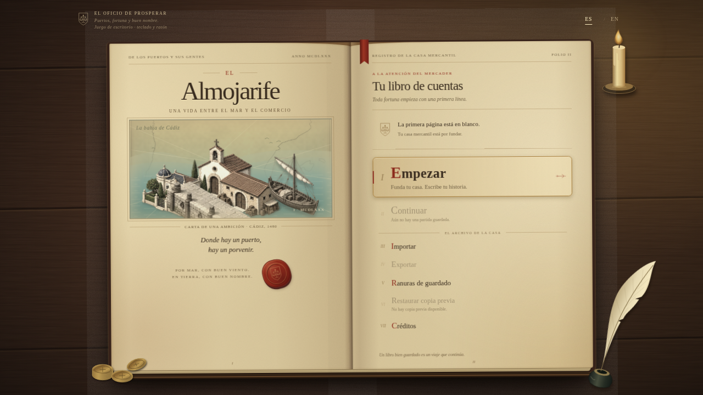
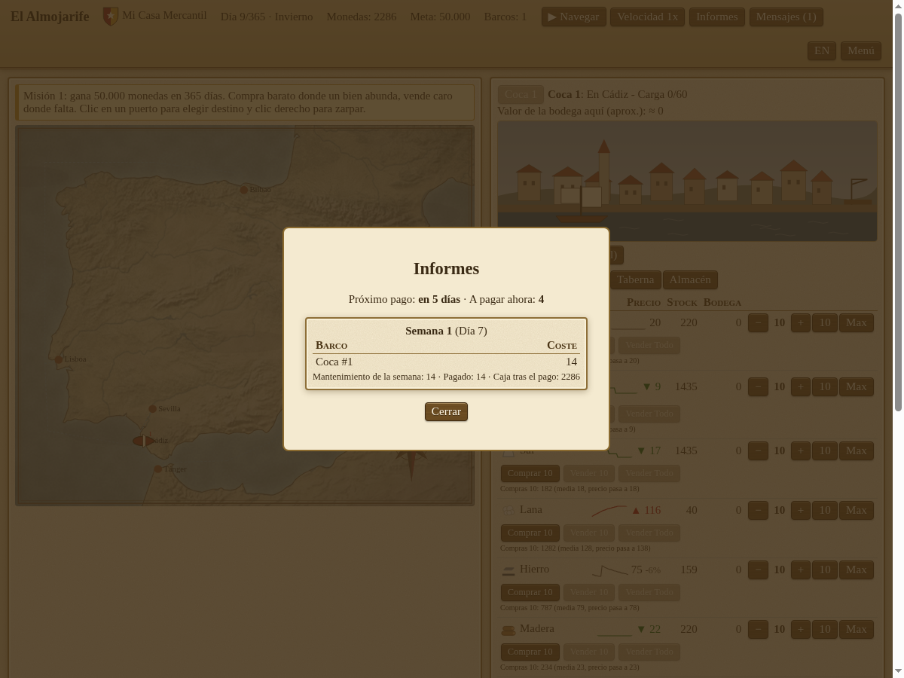
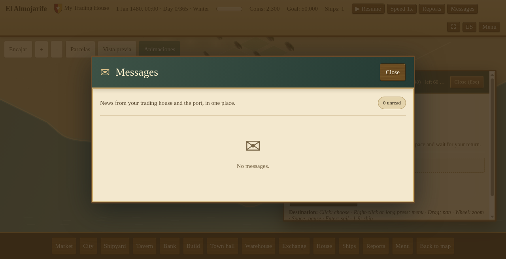

<h1 align="center">El Almojarife</h1>

<em>An open-source sea-trading game on the Iberian and Mediterranean coast, 15th-16th century.</em> 
<a href="https://halcondeoro.github.io/almojarife-game/"><b>Play in your browser</b></a>

You are a small merchant with one cog and a few coins in a harbour town. Buy cheap where a good is plentiful, sail the sea lanes, sell dear where it is scarce, grow a fleet, and rise to the top rank: the **almojarife**, the royal treasurer who ran a port's trade (say it: al-mo-ha-REE-fay).

**Status: early alpha.** It is playable and free, but rough. The honest list of what is still missing for the alpha is below.

## Why you might like it

- **A living market.** 33 ports, 12 goods, prices that move with supply and demand. A 4-step signal next to each stock tells you at a glance how full the market is. Selling a big load crashes the price. AI traders compete with you.
- **A real sea chart.** Pan and zoom a hand-styled map built from public-domain Natural Earth data. Ships sail the lanes in real time. Ports you have not visited stay hidden until you buy a chart for them.
- **Your own trading house.** Name your company and character, pick a portrait, design a coat of arms and house colours, choose a home port and a background.
- **A full port.** Market, shipyard (pick a ship class on an illustrated slipway, build it, repair, sell), warehouse with a steward who keeps standing buy/sell orders, tavern (hire captains, buy news), bank (loans with weekly interest and a cap that grows with your rank), and your buildings: plots, houses, workshops, warehouses and offices.
- **Trade while you sleep.** Send a ship on an automatic route between ports, with optional price guards and a cash brake, and it keeps trading on its own.
- **Weekly books.** Ship upkeep is not charged on the spot. It is settled once a week, so you can plan prices and cash. Open **Reports** for the weekly ledger and **Messages** for your inbox (settlements, warnings).
- **Captains and the sea.** Captains with navigation, weather and defence skills change how a ship sails, weathers storms and fights pirates. Storms, pirates, fair winds and drifting cargo bring choices at sea; win a pirate fight and you may keep the enemy ship as a prize. Prices of ports you have not visited are rumours with an age and an error margin.
- **Ranks and respect.** Climb ranks by net worth (they unlock bigger loans and better ships), and earn respect port by port to open offices.
- **A 3D port (prototype).** A three.js harbour built from your game state: docked ships, warehouse, time of day. Desktop first.
- **Saves.** Autosave every day, Continue from the title screen, export and import your save as a file. Until launch the save format can change without migration: test saves from earlier builds are not preserved.
- **The game is playable in English and Spanish** from day one. No account, no server, no ads: it runs in your browser.
- **Open and clean.** MIT code, CC BY art, every asset credited. Nothing copied from other games.

## Screenshots

| Title | Create your house |
|---|---|
|  |  |
| **Trade in the market** | **Sail and store goods** |
|  |  |
| **Build ships at the slipway** | **Weekly ledger (Spanish UI)** |
|  |  |
| **Message inbox (Spanish UI)** | |
|  | |

## How to play

1. Pick a name and a home port, then **Start**.
2. First goal: earn **50,000 coins in 365 days**.
3. In the **Market** tab, look for the green ▼ (cheap: buy) and red ▲ (dear: sell) arrows.
4. Click a port on the map, or a **Sail to** button, then press **Sail** to move time. Your ship takes days to arrive.
5. Sell where the price is high. Build a second ship in the **Shipyard**. Press **Esc** for the menu.
6. Once a week ship upkeep is settled. Check **Reports** for the numbers and **Messages** for what happened. Keep cash for that day.

Controls on the map: mouse wheel or pinch to zoom, drag to pan, double click to reset.

## What is missing for the alpha

The game is being built in public, in small pull requests with tests and review. This is the honest state:

**Still missing or in progress:**

- **The campaign.** Today there is the opening goal (50,000 coins in 365 days) and a first tutorial chapter. The full mission arc (a data-driven mission engine, varied requirements, narrative, side missions and rewards) is being added mission by mission: the engine and the first missions are in open pull requests, the rest are queued.
- **Town-council contracts** (time-limited delivery jobs) are written and in review, not merged yet.
- **A city-centred interface.** Clicking a port or a docked ship will open the city view, P3-style; navigation will show a selected ship's route. In progress.
- **A balance pass.** We measure the game with an internal simulation harness (dozens of bot playthroughs). The honest numbers today: the opening goal is too easy for optimal play (simulated traders win around day 36), loans carry no real risk, and silk dominates profits. Fixes are queued behind the harness.
- **Difficulty selection** at the start of a game.
- **Smaller mechanics** already written and in review: a proper bankruptcy flow, and importing building materials for construction.
- **Sound, tutorial, full 3D for every city, world map by historical milestones.** Not started.
- **The name** "Almojarife" is provisional.

Dates are a plan, not a promise: alpha is targeted for 14 Jul 2027 and 1.0 for 28 Feb 2028. See [`docs/ROADMAP.md`](docs/ROADMAP.md) and [`docs/DESIGN.md`](docs/DESIGN.md).

## Run it yourself

You need Node 20 or newer and any static web server:

    npm run serve        # then open http://localhost:8080/web/index.html
    npm test             # simulation, AI traders, game logic, saves, ledger, 3D scene
    sh tools/fetch_data.sh   # downloads the coastline data (not stored in the repo)

The sea-chart background is rebuilt by `tools/build_background.py` from the Natural Earth raster; the finished image is in `assets/map/`.

## Repository map

`src/sim/` simulation core · `src/game/` game rules, saves, profile · `src/view/` map camera · `web/` browser UI · `data/` ports, lanes, goods · `assets/` art (each file credited in [`CREDITS.md`](CREDITS.md)) · `docs/` design, roadmap, decisions · `test/` tests.

## Working with AI coding agents

See [AGENTS.md](AGENTS.md) and the [model policy](docs/politica-modelos.md).

## Contribute

Ideas, bug reports, historical corrections and translations are welcome. Start with [`CONTRIBUTING.md`](CONTRIBUTING.md), [`CODE_OF_CONDUCT.md`](CODE_OF_CONDUCT.md) and [`TRANSLATING.md`](TRANSLATING.md). Open an issue before large changes. Every change goes through a pull request with tests and review. Good first steps: pick an item from [`docs/BACKLOG.md`](docs/BACKLOG.md), fix a translation string, or report a price that feels wrong.

## Licence and credits

- Code and game data: MIT ([`LICENSE`](LICENSE)).
- Original art and documents: CC BY 4.0 ([`LICENSE-ART.md`](LICENSE-ART.md)).
- Third-party material is limited to public domain, CC0 and CC BY; every file is listed with its source in [`CREDITS.md`](CREDITS.md). Map data: Made with Natural Earth.
- The name "Almojarife" is provisional. A free trademark search found no conflict (19 Oct 2026); this is not legal advice.
- Ideas and mechanics from other trading games are studied; no art, text, names, data or code are copied.
