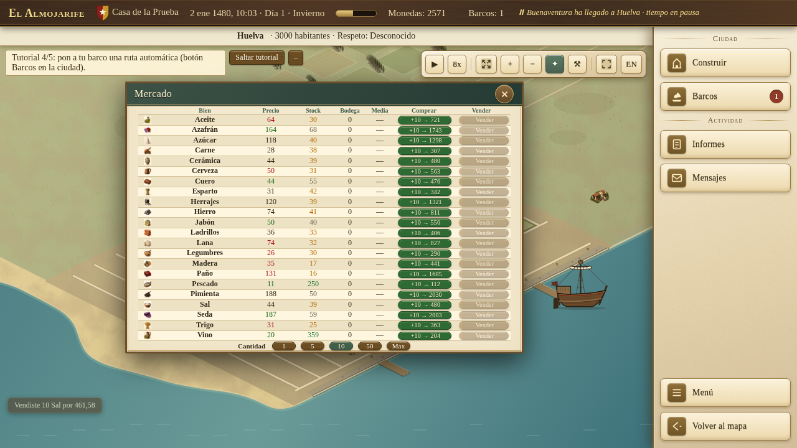
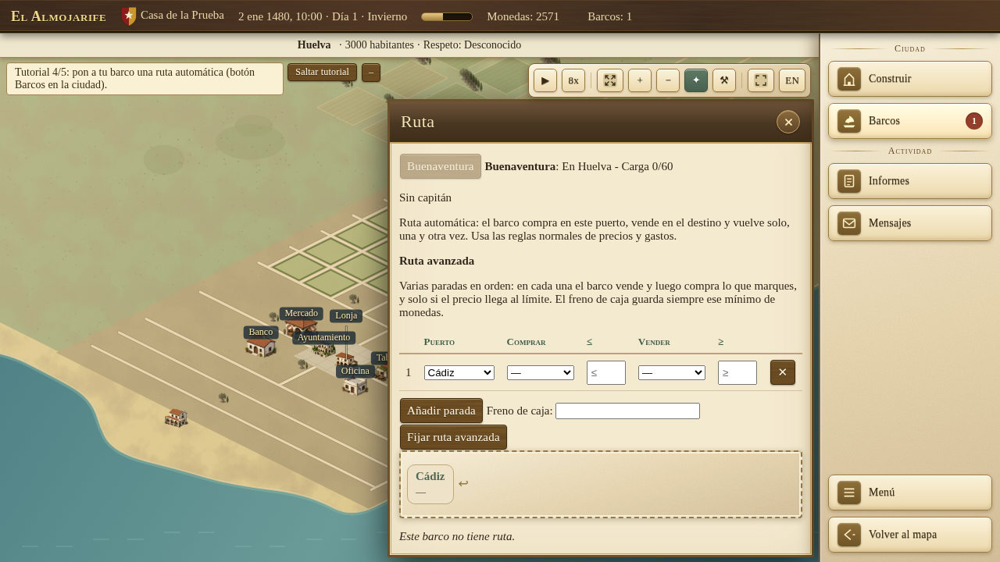
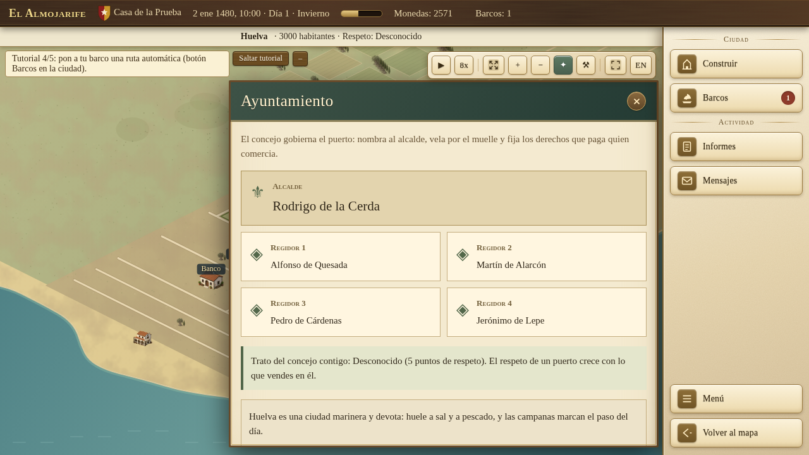

# Cómo jugar a El Almojarife

Guía del código integrado en `main` hasta `6102bc80` (28 de octubre de 2026). La web y los paquetes pueden ir por otro punto de control. Vuelve al [README](../README.md) para consultar las versiones. No incluye funciones de PR abiertos.

## 1. Empieza en el puerto

Crea tu casa mercantil y elige el puerto de origen. La partida nueva abre la ciudad. Haz clic en un edificio para abrir su ventana; el Mercado es el primer destino del tutorial. Puedes cerrar esa ventana y seguir viendo la ciudad. **Volver al mapa** cambia a la carta de navegación.

El tutorial actual tiene cinco pasos: comprar, vender con beneficio, navegar, fijar una ruta automática y visitar el Ayuntamiento. Un viaje hecho después de comprar queda registrado aunque la venta con beneficio ocurra al llegar. La campaña de misiones queda en espera mientras el tutorial siga activo. Puedes usar **Saltar tutorial**; en Ajustes se puede reiniciar uno ya terminado o saltado. Las partidas antiguas pueden conservar un tutorial distinto.

## 2. Compra y vende con cuidado

Elige una cantidad en Mercado antes de comprar o vender. Comprueba el precio y el espacio de bodega. No basta con que un bien parezca barato: cuenta lo pagado, los costes del viaje y lo que recibirás al vender. La oferta y la demanda cambian; una carga grande puede cambiar los precios.

Para el tutorial, vender mercancía comprada con beneficio real sí cuenta. Vender con pérdida, vender carga gratuita o dejar que una ruta automática venda por ti no sustituye ese paso manual.

**Prueba jugada de esta guía:** compra de sal en Cádiz, viaje real a Huelva y venta con beneficio. Es una comprobación de funcionamiento, no una receta de beneficio garantizado para cualquier partida.

## 3. Ordena un viaje y controla el reloj

En las partidas nuevas con navegación libre, selecciona tu barco y haz **clic derecho** en un puerto explorado o en un punto de mar permitido. No hace falta un segundo botón Zarpar. El puntero muestra una previsión; un destino inválido muestra un aviso rojo y no crea una ruta válida. Un puerto conocido solo por su carta no equivale a un puerto explorado.

El reloj debe avanzar para completar el viaje. **Reanudar** pone el tiempo en marcha; el botón de velocidad cambia su ritmo. El espacio pausa o reanuda en el mapa cuando no escribes en un campo. Algunas ventanas y sucesos detienen el tiempo; mira el estado del reloj si el barco parece parado.

Las partidas antiguas sin navegación libre mantienen el flujo anterior de elegir destino y **Zarpar**. No confundas esa compatibilidad con los controles de una partida nueva.

## 4. Usa el mapa sin cambiar la orden del barco

- Rueda o `+` / `-`: zoom. Arrastrar, flechas o `WASD`: desplazar la carta.
- **Centrar barco** o `Inicio`: localizar el barco seleccionado. **Centrar puerto** o `C`: localizar su puerto. El centrado acerca la vista al menos a 2×.
- Al acercar aparece el minimapa. Haz clic o arrastra en él para mover la cámara; no da una orden de navegación.
- Doble clic restablece el encuadre. `Esc` cierra ventanas o cancela la selección; abre **Menú** para guardar o ajustar la partida.
- La leyenda diferencia la red tenue, el viaje activo, una automática, un plan y un destino inválido. El color no sustituye la información de destino y llegada de la tarjeta del barco.

Los atajos de cámara no actúan mientras escribes en una entrada de texto. En la ventana del barco, **Seguir barco** activa la cámara de seguimiento. La rueda mantiene el seguimiento; `Esc`, arrastrar o desplazar/centrar manualmente lo cancelan. **Dejar de seguir** lo apaga. Este estado de vista no se guarda ni modifica la simulación.

## 5. Delega el comercio con una ruta automática

En una ciudad, abre **Barcos**. La ruta sencilla permite elegir los puertos y la mercancía de cada sentido; pulsa **Fijar ruta** para aplicarla. Comprueba el resumen del barco. Las opciones avanzadas permiten varias escalas, bienes de compra/venta, límites de precio y una reserva mínima de dinero.

Una ruta fijada no garantiza beneficio: puede quedarse sin mercancía, dinero o condiciones adecuadas. Revisa la carga, los avisos, las vueltas y las cuentas. Para el tutorial actual, fija la ruta después del primer viaje y de la venta con beneficio; visita entonces el **Ayuntamiento**.

## 6. Amplía la casa sin perder las cuentas

El Astillero permite construir y reparar. La venta de barcos está en la almoneda del Ayuntamiento: no se vende el último barco ni uno con carga. La taberna, el banco, los almacenes y los edificios tienen sus propios requisitos y costes, que debes leer antes de confirmar. Los contratos pueden tener plazos.

Consulta **Informes** para el historial y las cuentas semanales. **Mensajes** reúne avisos, resultados y sucesos. Reserva efectivo para la liquidación: tener mercancía o edificios valiosos no equivale a tener dinero disponible. No se promete una victoria automática por llegar a una cifra; las partidas nuevas usan campaña y tutorial, mientras que algunas antiguas conservan objetivos previos.

## 7. Guarda y vuelve

Usa **Menú** para guardar, gestionar ranuras, exportar/importar y abrir Ajustes. **Continuar** recupera la partida guardada desde la pantalla inicial. El guardado del navegador es local: no esperes verlo en otro navegador o dispositivo. Exporta una copia antes de borrar datos del sitio o cambiar de versión; una beta puede cambiar el formato.

La partida de prueba de esta guía se recargó, continuó y conservó el progreso del tutorial. No prueba todas las combinaciones de guardados antiguos ni la instalación de paquetes de escritorio.

## Qué se ha comprobado

Partida nueva real en español, 1280×720, código `ace71d6`, sin inyectar barcos, dinero ni escenarios: compra, orden con clic derecho, viaje, venta con beneficio, recarga/Continuar, ruta automática y visita al Ayuntamiento. Los cinco indicadores del tutorial terminaron en verdadero. Las capturas pertenecen a esa partida. Los controles de cámara y el desplegable de renombrado se comprobaron además mediante la interfaz en partidas reales durante la revisión de navegación; sus funciones corresponden al código integrado, no a una promesa de despliegue.
